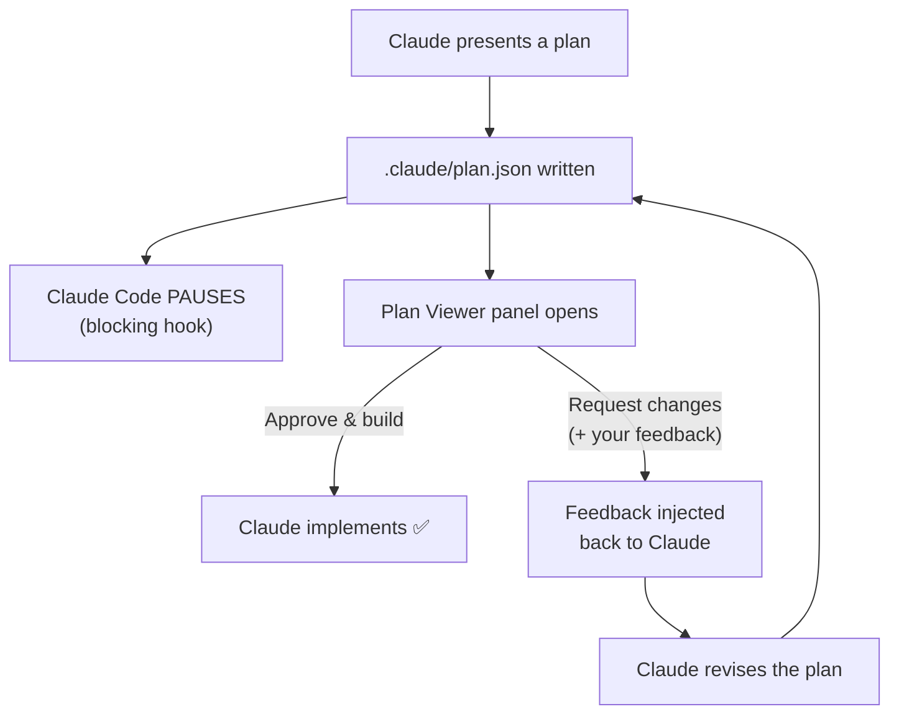
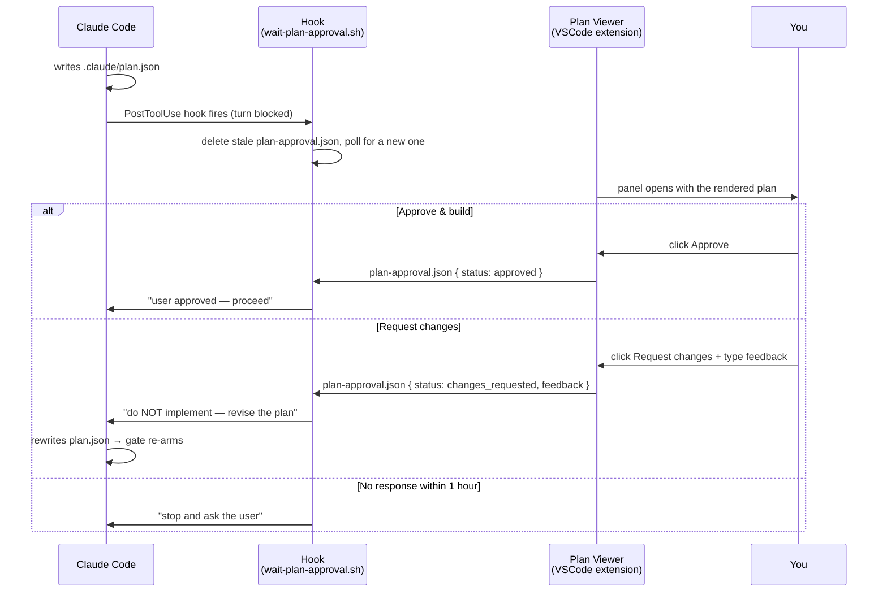

# Claude Plan Viewer

[](https://github.com/charanportion/Claude-Plan-Viewer/actions/workflows/ci.yml)
[](LICENSE)
[](CONTRIBUTING.md)

**A visual approval gate for Claude Code plans.** Claude writes its plan to `.claude/plan.json`, this VSCode extension renders it as an interactive panel — and Claude Code **pauses until you click Approve**. Click *Request changes* instead, type your feedback, and Claude revises the plan and waits again.



## Why

Claude Code's built-in plan approval shows the plan as a wall of markdown in the terminal. This extension gives you:

- **A structured, scannable view** — files touched (create/modify/delete tags), numbered steps with checkboxes you can tick off during implementation, risks, and out-of-scope items.
- **A hard gate** — Claude cannot start implementing until you explicitly approve *in the viewer*, even in auto-accept modes.
- **A feedback loop** — "Request changes" sends your notes straight back into Claude's context; it revises the plan and the gate re-arms for the new version.
- **A paper trail** — every plan is a JSON file you can diff, commit, or review later.

## How it works

Three pieces cooperate:

1. **This extension** watches `.claude/plan.json` in your workspace. When it appears or changes, the panel opens beside your editor. The Approve / Request-changes buttons write `.claude/plan-approval.json`.
2. **A Claude Code hook** (`wait-plan-approval.sh`) fires whenever Claude writes `.claude/plan.json`. It deletes any stale approval file, then blocks Claude's turn (up to 1 hour) polling for a fresh one:
   - `approved` → Claude is told to proceed.
   - `changes_requested` → your feedback is injected back and Claude is told to revise the plan, not implement.
   - timeout → Claude is told to stop and ask you.
3. **A second hook + a CLAUDE.md rule** make sure Claude actually writes `plan.json` every time it presents a plan (the hook covers plan mode deterministically; the CLAUDE.md rule covers plans presented as plain text).

No servers, no APIs — the two sides communicate through two small JSON files in `.claude/`.



## Installation

### 1. Install the extension

From a packaged `.vsix` (see [Releases](../../releases), or build one yourself):

```bash
code --install-extension claude-plan-viewer-0.0.1.vsix
```

Or build from source:

```bash
git clone <this repo>
cd plan-viewer
npm install
npm run compile
npx @vscode/vsce package --allow-missing-repository --skip-license
code --install-extension claude-plan-viewer-0.0.1.vsix
```

Reload your VSCode window after installing.

### 2. Wire up Claude Code (per project)

From the `claude-setup/` folder of this repo, in the project where you use Claude Code:

```bash
mkdir -p .claude/hooks
cp claude-setup/wait-plan-approval.sh .claude/hooks/
chmod +x .claude/hooks/wait-plan-approval.sh
```

Then merge the hooks from [`claude-setup/settings.example.json`](claude-setup/settings.example.json) into your project's `.claude/settings.json` (team-wide) or `.claude/settings.local.json` (just you). If the file already has a `hooks` section, add the two `PostToolUse` entries to it — don't replace existing hooks.

Finally, copy the "Plan File Contract" section from [`claude-setup/CLAUDE.example.md`](claude-setup/CLAUDE.example.md) into your project's `CLAUDE.md`.

> **Requirements:** `jq` and `bash` on your PATH (macOS/Linux; on Windows use WSL or Git Bash), VSCode ≥ 1.85, Claude Code with hooks support.

### 3. Try it

Start a Claude Code session in the project and ask:

```
Make a plan to add a file called hello.txt containing "hello world" to the
project root. Present the plan first — do not implement until approved.
```

You should see Claude write the plan, then pause with *"Waiting for plan approval in Plan Viewer…"* while the panel opens. Try **Request changes** first to watch the revision loop, then **Approve & build**.

## The plan.json schema

Claude is instructed (via hook + CLAUDE.md) to write plans in this shape — see [`claude-setup/plan.example.json`](claude-setup/plan.example.json) for a filled-in example:

```jsonc
{
  "summary": "One-line description of the plan",
  "files": [
    { "path": "src/foo.ts", "action": "create|modify|delete", "why": "reason" }
  ],
  "steps": [
    { "id": "1", "title": "What this step does", "file": "src/foo.ts" }
  ],
  "risks": ["What could break, what is assumed"],
  "out_of_scope": ["What is deliberately NOT being done"]
}
```

The viewer renders anything matching this schema — you can also open it manually with the **`Claude: Open Plan Viewer`** command.

## Troubleshooting

| Symptom | Fix |
|---|---|
| Claude doesn't pause after writing the plan | The session hasn't loaded the new hooks — run `/hooks` once in Claude Code, or restart the session. |
| Panel doesn't open | Reload the VSCode window; check the extension is installed (`code --list-extensions`). The watcher only fires for `.claude/plan.json` in the **first** workspace folder. |
| Approve click does nothing | Check the "Claude Plan Viewer" output channel for errors; make sure the workspace folder is writable. |
| Claude proceeds without plan.json for text plans | Only plan-mode plans are gated deterministically. Free-text plans rely on the CLAUDE.md rule — make sure you copied it. |
| Hook blocks on manual edits of plan.json | Expected — editing `plan.json` by hand re-arms the gate. Just click Approve. |

Add these to your `.gitignore` — they're session artifacts:

```
.claude/plan.json
.claude/plan-approval.json
```

## Repo layout

```
├── src/extension.ts           # extension: watcher, webview panel, approval-file writer
├── media/viewer.js            # webview UI: plan rendering + Approve / Request changes
├── claude-setup/
│   ├── wait-plan-approval.sh  # the blocking Claude Code hook (copy to .claude/hooks/)
│   ├── settings.example.json  # hooks to merge into .claude/settings.json
│   ├── CLAUDE.example.md      # plan-contract section to copy into CLAUDE.md
│   └── plan.example.json      # sample plan matching the schema
└── package.json
```

## Contributing

Contributions are welcome — see [CONTRIBUTING.md](CONTRIBUTING.md). Because this project runs code on users' machines (a VSCode extension plus a bash hook that gates an AI agent), all changes land through reviewed pull requests, CI must pass, and a maintainer must approve. Please also read the [Code of Conduct](CODE_OF_CONDUCT.md).

Found a security issue? **Do not open a public issue** — follow [SECURITY.md](SECURITY.md).

## License

MIT — see [LICENSE](LICENSE).
